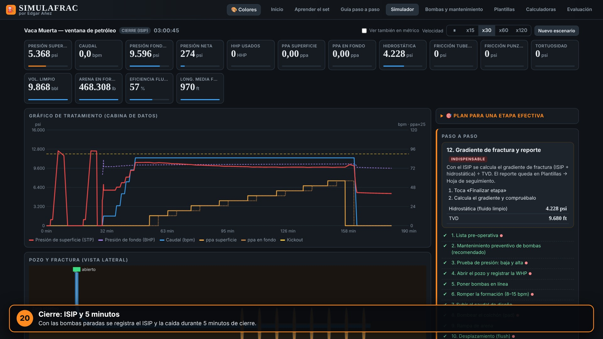

# SimulaFrac (Edgar Añez)

**Simulador de fractura hidráulica y mantenimiento de bombas**, con ejemplos de Vaca Muerta.
Funciona en el navegador (PC y celular), sin instalar nada y sin iniciar sesión.

👉 **Usar la app:** https://eanez13.github.io/simulafrac/

🎬 **Video instructivo:** [media/SimulaFrac_instructivo.mp4](media/SimulaFrac_instructivo.mp4)

## Qué incluye

- **Simulador de una etapa completa:** lista pre-operativa, prueba de presión (baja y alta), apertura del pozo, rotura, subida de caudal, colchón, rampa de arena, desplazamiento, cierre (ISIP) y gradiente de fractura.
- **Paso a paso guiado** con los valores a observar en vivo y el **plan para una etapa efectiva** calculado para cada pozo.
- **Puntos indispensables:** si falta alguno, la etapa no es válida.
- **Bombas y mantenimiento:** revisión de flota al inicio, fallas con diagnóstico exacto (cilindro, síntoma y qué cambiar), orden de mantenimiento con LOTO, vista previa de cada componente y bomba al 100% después de la reparación.
- **Modelos de bomba** (SPM EXL, QWS-2500, Destiny TWS-2500 y otras marcas) con cálculo por diámetro de émbolo: presión máxima por rod load y caudal por bomba.
- **Escenarios de Vaca Muerta** (petróleo, gas y desafío) y pozo escuela.
- **Plantillas:** datos del pozo (con la fuente de cada valor), checklist, hoja de seguimiento de etapa y orden de mantenimiento.
- Calculadoras, evaluación y paleta de colores totalmente personalizable.
- **Cuentas y membresía:** registro dentro de la app, 7 días gratis con todo incluido y luego US$ 5 por mes. El pozo escuela, la guía y la evaluación son gratis. Ver [docs/MEMBRESIA.md](docs/MEMBRESIA.md) para activar el cobro con Mercado Pago.

## Aviso

Es una herramienta **didáctica** con un modelo simplificado. No reemplaza al software de diseño de fractura ni a los procedimientos, manuales de fabricante y programas de cada operación. Los valores de Vaca Muerta y de las bombas son típicos y de fuentes públicas.

Los datos (historial, plantillas y colores) se guardan solo en el navegador de cada usuario.

---
Autor: **Edgar Añez Monzon** — Ingeniero en Petróleo · Neuquén, Argentina
